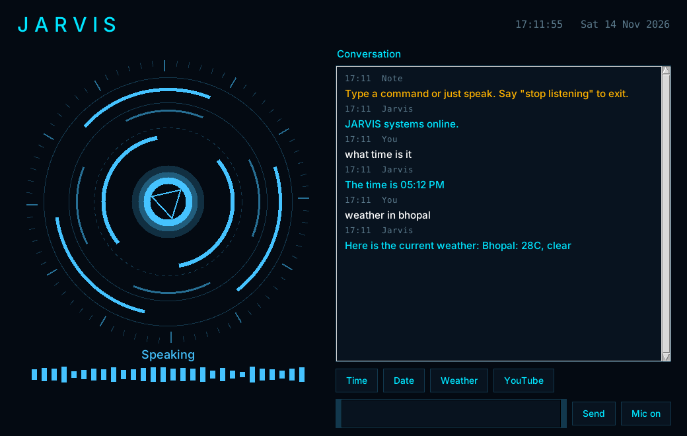

# JARVIS — Python AI Voice Assistant

A beginner-friendly Windows/Python voice assistant with:
- A JARVIS-style HUD window (animated arc reactor, conversation log, typed commands, mic toggle)
- Speech-to-text using SpeechRecognition's Google recognizer (internet required)
- Text-to-speech using pyttsx3 (local voice output)
- Built-in commands: time, date, open selected websites, Google search, weather
- Optional AI conversations through the OpenAI Responses API
- Short conversation history during the current run

## 1. Requirements
- Windows 10/11
- Python 3.10 or newer
- Working microphone and speakers
- Internet for speech recognition, weather, web search, and AI responses
- An OpenAI API key only if you want AI conversation mode. API usage may incur charges.

## 2. Setup (PowerShell in VS Code)

Open this project folder in VS Code, then run:

```powershell
py -m venv .venv
.\.venv\Scripts\Activate.ps1
python -m pip install --upgrade pip
pip install -r requirements.txt
```

If PowerShell blocks activation, use Command Prompt instead:

```bat
.venv\Scripts\activate.bat
```

### PyAudio installation note
PyAudio can sometimes fail to install on Windows due to audio build dependencies. First try:

```powershell
python -m pip install pipwin
pipwin install pyaudio
```

If that does not work, use a compatible prebuilt PyAudio wheel for your exact Python version and Windows architecture, or use a supported Python version (often 3.11/3.12 has broader wheel availability). Do not download random executables.

## 3. Configure AI (optional)

1. Copy `.env.example` and name the copy `.env`.
2. Add your API key after `OPENAI_API_KEY=`.
3. Keep `.env` private. Never commit it to GitHub.
4. The model name can be changed with `OPENAI_MODEL` if your account has access to another model.

Without a key, built-in commands still work. AI conversations will give a setup reminder.

## 4. Run

```powershell
python main.py          # opens the HUD window
python main.py --cli    # terminal-only mode
```

In the HUD window you can speak, type into the box, or click a quick button
(Time, Date, Weather, YouTube). The **Mic on/off** button pauses listening
while typed commands keep working. The reactor changes colour with the state:
cyan = standby, green = listening, amber = thinking, blue = speaking.

## Output



Try saying:
- "What time is it?"
- "Tell me today's date"
- "Open YouTube"
- "Open GitHub"
- "Search for Python decorators"
- "Weather in Bhopal"
- "Explain what an API is"
- "Stop listening"

## 5. Architecture

```text
Microphone
   |
   v
speech.py  -- Speech-to-text (STT)
   |
   v
assistant.py -- routes recognized text
   |                         |
   | built-in command        | general question
   v                         v
commands.py                ai_brain.py
   |                         |
   |                         v
   |                    LLM API (optional)
   |                         |
   +------------+------------+
                |
                v
          speech.py -- Text-to-speech (TTS)
                |
                v
             Speaker
```

## 6. Understand the modules

- `main.py`: starts the application (HUD window by default, `--cli` for terminal).
- `gui.py`: Tkinter HUD window; runs the assistant in a background thread.
- `speech.py`: microphone capture, STT, and TTS.
- `assistant.py`: main control loop and routing.
- `commands.py`: explicit safe commands the assistant can execute.
- `ai_brain.py`: sends general questions to the LLM API and keeps recent chat history.
- `config.py`: reads settings from `.env`.

## 7. Safety and limitations

- This starter project does not execute arbitrary shell commands.
- It opens only the websites listed in `commands.py`.
- Speech recognition uses an online service; recognized audio is sent to that service for transcription.
- AI requests are sent to the configured API provider.
- The assistant does not have a wake word yet; it listens for one phrase at a time.
- Weather is retrieved from wttr.in and may occasionally be unavailable.

## 8. Five-day learning plan

**Day 1:** Run the project; understand microphone input, STT, TTS, and Python modules.

**Day 2:** Configure the API key; understand the LLM request, response, and prompt.

**Day 3:** Study the assistant loop, conversation history, timeouts, and error handling.

**Day 4:** Add one or two safe commands; test edge cases and permissions.

**Day 5:** Draw the architecture, explain each file, record a demo, and prepare the README/GitHub repository.

## 9. Troubleshooting

- `No module named ...`: activate the virtual environment and run `pip install -r requirements.txt`.
- `PyAudio` / microphone error: verify Windows microphone permission and the PyAudio installation.
- No speech detected: check the selected Windows input device and microphone level.
- Google recognition request error: check internet connectivity.
- AI says it cannot connect: check `.env`, API key validity, model access, billing/limits, and internet.
- No sound: check Windows output device and volume; `pyttsx3` uses installed system voices.

## 10. Author

Built by **Your Name** — replace this line with your name, GitHub profile and date.
